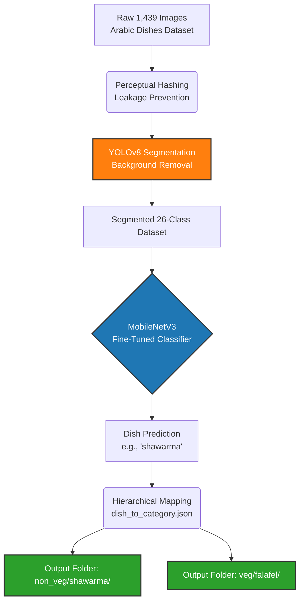

# Phase 5: Dish-Wise Hierarchical Classifier Visualization

This dashboard visualizes the data flow, architecture, and training results for the final hierarchical classification phase.

## 1. System Architecture Flow
The following flowchart illustrates how raw datasets are processed, segmented, and fed into the deep learning pipeline, ultimately being sorted into a logical hierarchical structure.

> [!NOTE]
> The **YOLOv8 Segmentation** step is critical for removing noisy backgrounds (like tables or hands), forcing the MobileNetV3 model to learn only the texture and shape of the food itself.

## 2. Model Training Curves
The following graph visualizes the Loss and Accuracy during the 24 epochs of Stage 2 fine-tuning. 

> [!TIP]
> Notice how the **Validation Loss (orange line)** begins to plateau and slightly rise near Epoch 15-20. The training script automatically triggered **Early Stopping** at Epoch 24 to prevent the model from overfitting to the training data.

## 3. Class Confusion Matrix
This matrix details the model's exact predictions across all 26 classes. The bright yellow diagonal represents correct predictions, while scattered points off the diagonal represent where the model confused one dish for another.

> [!IMPORTANT]
> The heavy cluster of errors (the lighter squares off the main diagonal) usually occurs between visually indistinguishable dishes like **Mandi**, **Madfoon**, and **Kabsa** — which all consist of roasted meat over spiced rice.
